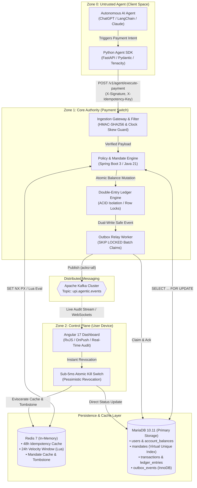
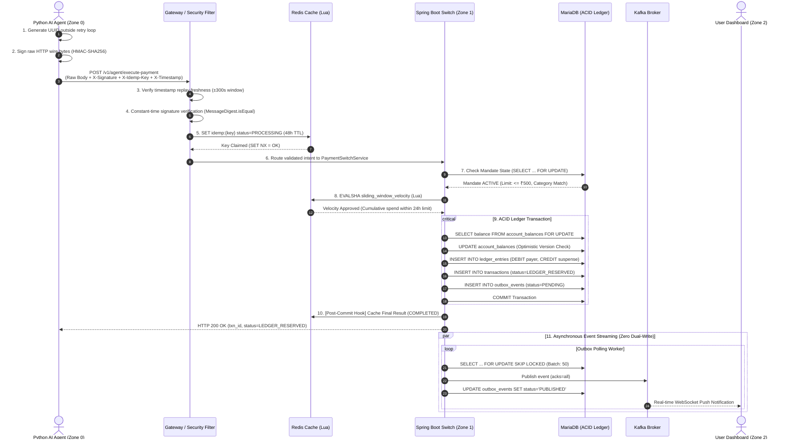
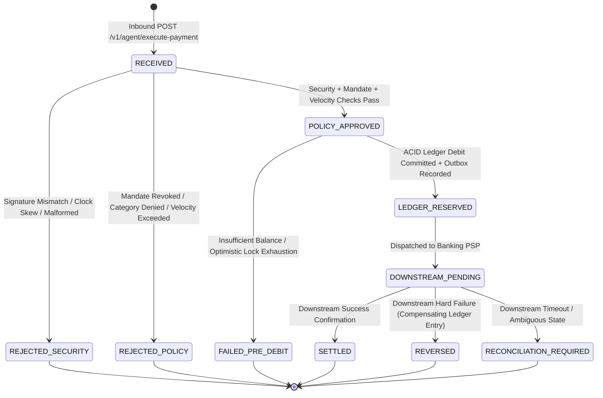
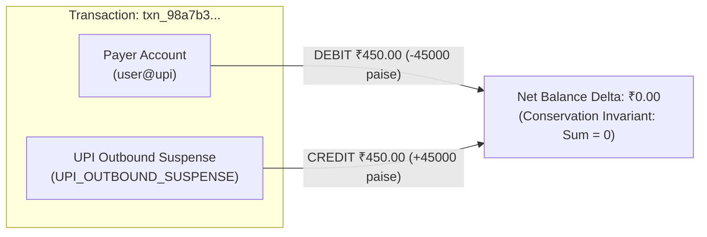
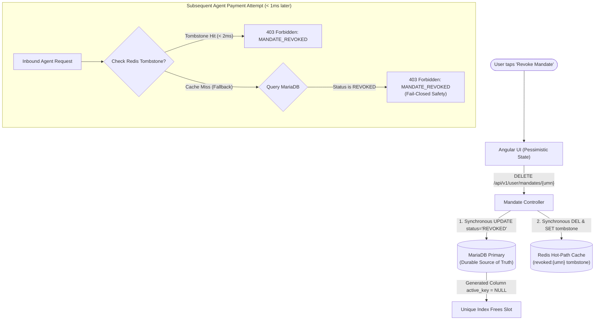

# ⚡ AgenticUPI — Autonomous AI Micropayments Switch

<div align="center">

[](https://openjdk.org/)
[](https://spring.io/projects/spring-boot)
[](https://www.python.org/)
[](https://fastapi.tiangolo.com/)
[](https://angular.io/)
[](https://mariadb.org/)
[](https://redis.io/)
[](https://kafka.apache.org/)
[](https://www.docker.com/)

**A high-concurrency, zero-trust distributed payment switch enabling autonomous AI agents to execute low-value UPI micropayments (≤ ₹500) without human PIN prompts — backed by cryptographic boundary enforcement, sliding-window velocity caps, double-entry accounting, and sub-5ms atomic kill-switches.**

[Architecture](#-system-architecture) •
[Sequence Flow](#-end-to-end-request-lifecycle) •
[State Machine](#-transaction-state-machine) •
[Key Engineering Decisions](#-key-architectural-decisions--engineering-highlights) •
[Threat Model](#-stride-threat-model--security-boundaries) •
[Quickstart](#-getting-started) •
[Docs](#-deep-dive-documentation)

</div>

---

## 📌 Executive Summary & The Problem

As autonomous LLMs and agentic workflows (ChatGPT, Claude, AutoGPT, Devins) evolve to perform real-world tasks — booking Uber rides, acquiring compute on spot markets, paying for paywalled research, or triggering SaaS APIs — they require the ability to transact financially.

### The Autonomy-Security Dilemma

| Approach | Latency / Friction | Security & Financial Risk |
| :--- | :--- | :--- |
| **Traditional UPI (2FA / PIN Prompt)** | 🔴 **Breaks autonomy**: Human must unlock their phone and enter a 6-digit MPIN for every ₹20 API call. | 🟢 High security, but zero autonomy. |
| **Naive Agent Card/API Key Delegation** | 🟢 **Full autonomy**: The model holds a card token or raw gateway secret. | 🔴 **Catastrophic risk**: Prompt injection, runaway loops, or replay attacks can drain user accounts with zero recourse. |
| **AgenticUPI Switch (This Architecture)** | 🟢 **Sub-25ms autonomous path**: Delegated mandates execute without human PIN prompts. | 🟢 **Deterministic safety**: Strict ₹500 caps, rolling 24h velocity windows, raw-byte HMAC auth, transactional outbox, and sub-5ms kill-switches. |

AgenticUPI is a **production-grade, zero-mock distributed payment engine** designed for high-throughput fintech infrastructure (modeled on UPI PSP architecture). It strictly compartmentalizes trust across three distinct security zones.

---

## 🏛 System Architecture

The system is strictly partitioned into three isolated zones with deterministic trust boundaries:



### Trust Boundary Definitions

* **Zone 0 (Untrusted)**: The AI Agent (`agent-python`). Assumed hostile or vulnerable to prompt injections. Has no direct DB or ledger access. Must authenticate every HTTP request via raw-byte HMAC-SHA256.
* **Zone 1 (Core Authority)**: The Payment Switch (`backend-java`). Spring Boot application enforcing strict ACID guarantees, pessimistic row locking (`SELECT FOR UPDATE`), two-phase velocity checks, double-entry ledgers, and transactional outbox.
* **Zone 2 (Control Plane)**: The User Dashboard (`frontend-angular`). Enables real-time balance tracking, audit streaming, and instant mandate revocation via pessimistic kill-switches.

---

## 🔄 End-to-End Request Lifecycle

The diagram below outlines the full lifecycle of a warm-path micro-payment, from agent dispatch to distributed outbox publishing:



---

## 📊 Transaction State Machine

To protect the financial switch from ambiguous external network timeouts, the core engine isolates **Authorization**, **Ledger Reservation**, and **Settlement**:



> **Financial Integrity Invariant**: Once `LEDGER_RESERVED` is committed, any subsequent failure or reversal is resolved strictly via **compensating double-entry ledger rows**. Rows in `ledger_entries` and `transactions` are immutable and never updated or deleted in place.

---

## ⚖ Double-Entry Ledger Accounting

In compliance with banking standard practices, balance modifications cannot occur in isolation. Every transaction maintains strict zero-sum conservation:



$$\sum \Delta \text{LedgerBalance} = 0$$

* All monetary values are represented as integer **paise** (`BIGINT`), avoiding IEEE 754 floating-point rounding errors.
* The Payer balance row is locked with `PESSIMISTIC_WRITE` (`SELECT ... FOR UPDATE`) accompanied by an `@Version` column to catch optimistic race conditions.

---

## 🛑 Sub-5ms Atomic Kill-Switch

When a user suspects unauthorized agent behavior, tapping "Revoke" must guarantee instantaneous termination of spending authority across all pods.



### Generated Column for Partial Unique Index
MariaDB 10.11 lacks native partial indexes (`WHERE status = 'ACTIVE'`). To allow users to create new mandates after revoking old ones while preventing multiple concurrent active mandates, we employ a virtual generated column:

```sql
active_key VARCHAR(150) AS (
    IF(status IN ('ACTIVE','PAUSED'), CONCAT(agent_id, '_', user_vpa), NULL)
) VIRTUAL,
UNIQUE KEY idx_unique_active_mandate (active_key);
```
* If `status` is `ACTIVE` or `PAUSED`, `active_key` is populated. The database strictly rejects duplicates.
* If `status` is `REVOKED` or `EXPIRED`, `active_key` evaluates to `NULL`. Because standard SQL ignores `NULL` in unique constraints, users can retain infinite historical audit records of revoked mandates!

---

## 🏆 Key Architectural Decisions & Engineering Highlights

### 1. Raw-Byte HMAC-SHA256 Signing (vs. JSON Canonicalization)
* **The Failure Mode**: Polyglot architectures (Python FastAPI + Java Spring Boot) often suffer signature verification mismatches when trying to canonicalize JSON. Python's `json.dumps()` and Java's Jackson serialize floats, spaces, unicode, and key orders differently.
* **The Solution**: The Python client hashes the exact raw bytes that are sent on the wire 
  $$\text{signature\base} = \text{SHA256}(\text{raw\body\bytes}) + "." + \text{timestamp} + "." + \text{idempotency\key} + "." + \text{agent\id}$$
* **Timing-Attack Resistance**: The Java filter uses `MessageDigest.isEqual(expected, provided)` to ensure constant-time comparison, and immediately zeroizes the decrypted secret byte array in memory using `Arrays.fill(rawSecret, (byte) 0)`.

### 2. Resilient Idempotency Key Lifecycle
* **The Failure Mode**: Generating a new UUID inside the network retry block leads to silent double debits if a request times out after the server committed it.
* **The Solution**: The idempotency key is generated **once before the retry loop**. The Tenacity retry policy retries *only* on explicit network timeouts (`httpx.ReadTimeout`), re-transmitting the exact same key.
* **Two-Tier Validation**:
  1. **Redis Fast-Path**: `SET idemp:{key} {hash}:PROCESSING NX PX 172800000` (48h TTL).
  2. **MariaDB Hard Stop**: `UNIQUE KEY idx_idempotency (idempotency_key, agent_id)` blocks parallel commits at the storage engine level.
  3. **Hash Conflict Detection**: If the same idempotency key is submitted with altered payload content, the switch immediately raises `409 IDEMPOTENCY_CONFLICT`.

### 3. Two-Phase Velocity Reservations via Redis Lua
* **The Failure Mode**: Checking spend limits in application code and updating later creates a Time-Of-Check-To-Time-Of-Use (TOCTOU) race condition during concurrent agent bursts.
* **The Solution**: Atomic sliding-window velocity checks executed in a single Redis Lua script:
  1. `ZREMRANGEBYSCORE` removes entries older than 24 hours ($T - 86400000\text{ms}$).
  2. `ZRANGEBYSCORE` sums existing consumption.
  3. Rejects if $\text{sum} + \text{amount} > \text{daily\limit}$.
  4. Reserves the amount atomically.
* **Cache-DB Synchronization**: Uses Spring's `TransactionSynchronizationManager.registerSynchronization` post-commit hooks. If the MariaDB transaction succeeds, the reservation is confirmed. If MariaDB rolls back (e.g. balance check fails), the Redis reservation is evicted so the user does not leak quota.

### 4. High-Throughput Transactional Outbox Relay (`SKIP LOCKED`)
* **Dual-Write Elimination**: Rather than trying to commit to MariaDB and publish to Kafka in the same flow, event rows are inserted into `outbox_events` in the exact same ACID transaction as the ledger debit.
* **Lock-Free Polling**: Multiple background workers poll the table using:
  ```sql
  SELECT * FROM outbox_events WHERE status = 'PENDING'
  ORDER BY created_at LIMIT 50 FOR UPDATE SKIP LOCKED;
  ```
  `SKIP LOCKED` allows concurrent workers to claim distinct batches simultaneously without lock contention or deadlocks.
* **Claim-Publish-Ack**: The worker claims rows, releases DB locks, publishes messages to Kafka (`acks=all`), and writes back the `PUBLISHED` status in a quick secondary transaction.

---

## ⏱ Request Latency Budget & Capacity Model

Designed for sustained throughput of **10,000 TPS** and burst capacity of **15,000 TPS**:

| Pipeline Step | P50 (ms) | P95 (ms) | Bounded By | Technical Mechanism |
| :--- | :--- | :--- | :--- | :--- |
| **TLS & Ingestion Routing** | 0.5 ms | 1.0 ms | Network / IO | Reverse proxy & keep-alive connection reuse |
| **HMAC Signature Check** | 0.1 ms | 0.3 ms | CPU | Constant-time `MessageDigest.isEqual` |
| **Idempotency Claim** | 0.3 ms | 0.8 ms | Redis | Single Redis `SET NX PX` (48h TTL) |
| **Mandate Resolution** | 0.3 ms | 0.8 ms | Redis / Net | Cache-aside lookup with 5-minute TTL |
| **Velocity Check (Lua)** | 0.5 ms | 1.5 ms | Redis CPU | Single-round-trip atomic Lua script |
| **SELECT ... FOR UPDATE** | 1.0 ms | 3.0 ms | InnoDB Engine | Clustered index row lock on payer balance |
| **Ledger & Outbox Insert** | 1.0 ms | 3.0 ms | InnoDB IO | Local ACID transaction |
| **DB Commit & Fsync** | 1.0 ms | 5.0 ms | Disk IO | Group commits with semi-synchronous replication |
| **Post-Commit Cache Sync** | 0.3 ms | 0.8 ms | Redis | Asynchronous post-commit hook |
| **HTTP Serialization** | 0.2 ms | 0.5 ms | CPU | Jackson optimized serializer |
| **Total End-to-End Latency**| **6.3 ms** | **20.5 ms** | ✅ **SLA: < 25ms** | **Sub-50ms P99 even during peak bursts** |

---

## 🛡 STRIDE Threat Model & Security Boundaries

| Threat Category (STRIDE) | Attack Vector | Mitigation in AgenticUPI |
| :--- | :--- | :--- |
| **Spoofing (S)** | Attacker masquerades as an authorized agent with forged keys. | **Cryptographic Verification**: HMAC-SHA256 required on every request. Keys encrypted with KMS envelope encryption at rest. |
| **Tampering (T)** | Attacker alters payment amount or destination VPA in transit. | **Raw-Byte Payload Hashing**: The signature covers `SHA256(raw_body) + timestamp + idemp_key + agent_id`. Any bit flipped causes 401 Unauthorized. |
| **Repudiation (R)** | Rogue agent claims it never initiated a disputed payment. | **Immutable Double-Entry Ledger**: Signed idempotency keys, request hashes, and immutable debit/credit rows stored permanently in MariaDB. |
| **Information Disclosure (I)** | Error messages or logs leak balance, secrets, or internal stack traces. | **Sanitized Error Enums**: Strict `AgentErrorCode` returned to client. Internal stack traces suppressed. Secrets zeroized in memory immediately. |
| **Denial of Service (D)** | Prompt-injected agent floods system with repeated debit requests. | **Sliding-Window Velocity**: Rate limits enforced via token buckets and Redis sliding-window Lua script. Hard ₹500 transaction caps. |
| **Elevation of Privilege (E)** | Concurrent race conditions attempt to overdraft an account. | **Pessimistic Locking + Optimistic Versioning**: `SELECT FOR UPDATE` prevents simultaneous overdrafts. `@Version` guarantees monotonic updates. |

---

## 📁 Repository Structure

```text
AgenticUPI/
├── docker-compose.yml              # Complete 1-click orchestration (MariaDB, Redis, Kafka, Zookeeper)
├── README.md                       # High-level architecture documentation
├── dashboard.html                  # Interactive architectural visualization & monitoring dashboard
├── live-dashboard.html             # Standalone lightweight real-time monitoring console
│
├── backend-java/                   # Zone 1: Core Financial Switch (Spring Boot 3 + Java 21)
│   ├── src/main/java/com/agenticupi/
│   │   ├── config/                 # Security filters, HMAC validation, CORS, WebMvc configs
│   │   ├── controller/             # PaymentController, MandateController
│   │   ├── domain/                 # JPA Entities (AccountBalance, Mandate, Transaction, LedgerEntry, OutboxEvent)
│   │   ├── dto/                    # Strict DTO models (PaymentIntent)
│   │   ├── exception/              # AgentErrorCode enum and global exception handlers
│   │   ├── repository/             # Spring Data Repositories with custom pessimistic queries
│   │   └── service/                # PaymentSwitchService, IdempotencyService, OutboxRelayWorker
│   └── pom.xml
│
├── agent-python/                   # Zone 0: Untrusted Agent SDK (FastAPI + Pydantic + Tenacity)
│   ├── app/
│   │   ├── client.py               # AgenticUpiClient with raw-byte HMAC signing & connection pooling
│   │   ├── main.py                 # FastAPI orchestrator with Tenacity retry policies
│   │   └── models.py               # Strict Pydantic PaymentIntent schema & regex constraints
│   ├── Dockerfile
│   └── requirements.txt
│
├── frontend-angular/               # Zone 2: User Control Plane (Angular 17 + RxJS)
│   ├── src/app/
│   │   ├── components/             # MandateDashboardComponent with pessimistic revocation
│   │   ├── models/                 # Frontend interfaces
│   │   └── services/               # MandateService, WebSocket event stream consumers
│   └── package.json
│
├── infrastructure/                 # Infrastructure provisioning
│   └── mariadb-init/
│       └── 01-schema.sql           # Complete MariaDB schema with generated columns & seed data
│
└── docs/                           # Comprehensive Engineering Design Documentation (70KB+ Specs)
    ├── phase1-hld-architecture.md  # High-Level Design, SLAs, STRIDE threat analysis
    ├── phase2-data-models.md       # ER schemas, double-entry design, connection pool sizing
    ├── phase3-lld-backend.md       # Java Spring Boot low-level design, locking, and outbox relay
    ├── phase4-agent-service.md     # Python SDK, raw signing, idempotency key lifecycles
    └── phase5-ui-angular.md        # Angular architecture, RxJS streams, pessimistic kill-switch
```

---

## 🚀 Getting Started

### Prerequisites
* **Docker & Docker Compose** (Recommended for rapid testing)
* **Java 21 JDK** & **Maven 3.9+** (For local Java development)
* **Python 3.11+** (For local Python development)
* **Node.js 18+** & **npm** (For local Angular development)

---

### Method 1: Instant Start with Docker Compose (Recommended)

Spin up the entire distributed infrastructure (MariaDB, Redis, Kafka, Zookeeper) with one command:

```bash
# Clone the repository
git clone https://github.com/5andeepNambiar/AgenticUPI.git
cd AgenticUPI

# Launch MariaDB, Redis, Kafka, and Zookeeper
docker-compose up -d mariadb redis zookeeper kafka
```

Check service health:
```bash
docker-compose ps
```

---

### Method 2: Running Services Locally for Development

#### 1. Start Infrastructure Dependencies
```bash
docker-compose up -d mariadb redis kafka zookeeper
```

#### 2. Run the Java Payment Switch (Port 8080)
```bash
cd backend-java
./mvnw spring-boot:run
```
*The service will start on `http://localhost:8080` with database tables and seed data automatically initialized.*

#### 3. Run the Python Agent SDK (Port 8000)
```bash
cd ../agent-python
python3 -m venv venv
source venv/bin/activate
pip install -r requirements.txt

# Run the FastAPI server
uvicorn app.main:app --host 0.0.0.0 --port 8000 --reload
```

#### 4. Run the Angular Control Dashboard (Port 4200)
```bash
cd ../frontend-angular
npm install
npm start
```
*Visit `http://localhost:4200` to interact with the mandate governance portal.*

---

## 🧪 Verifying System Behavior via cURL

### 1. Test a Successful Agent Payment
Submit a structured payment intent through the Python Agent orchestrator:

```bash
curl -X POST http://localhost:8000/agent/execute-payment \
  -H "Content-Type: application/json" \
  -d '{
    "payer_vpa": "user@upi",
    "payee_vpa": "merchant@swiggy",
    "amount_paise": 25000,
    "currency": "INR",
    "category": "FOOD",
    "agent_context": "Ordering lunch delivery"
  }'
```

**Expected Response (`200 OK`)**:
```json
{
  "status": "success",
  "gateway_response": {
    "txn_id": "txn_89a42f89-72f1-4db8-bca7-53c846618e7e",
    "status": "LEDGER_RESERVED"
  }
}
```

---

### 2. Verify Double-Entry Accounting in MariaDB
Connect to MariaDB to inspect the balanced ledger entries and outbox records:

```bash
docker exec -it agenticupi_db mysql -u api_user -papi_password agenticupi -e "
  SELECT * FROM account_balances;
  SELECT entry_id, txn_id, account_id, direction, amount_paise FROM ledger_entries;
  SELECT event_id, aggregate_id, event_type, status FROM outbox_events;
"
```

You will observe:
1. `account_balances`: `balance_paise` reduced from `500000` (₹5000) to `475000` (₹4750).
2. `ledger_entries`: A `DEBIT` of `25000` on `user@upi` and an exact matching `CREDIT` of `25000` on `UPI_OUTBOUND_SUSPENSE`.
3. `outbox_events`: An event generated with status `PUBLISHED` after Kafka relay.

---

### 3. Test the Sub-5ms Atomic Kill-Switch
Revoke the agent's mandate via the User Control Plane API:

```bash
curl -X DELETE http://localhost:8080/api/v1/user/mandates/umn_demo_123
```

Now, re-attempt the payment from Step 1:
```bash
curl -X POST http://localhost:8000/agent/execute-payment \
  -H "Content-Type: application/json" \
  -d '{
    "payer_vpa": "user@upi",
    "payee_vpa": "merchant@swiggy",
    "amount_paise": 15000,
    "category": "FOOD"
  }'
```

**Immediate Rejection (`400 Bad Request`)**:
```json
{
  "detail": "Policy/Mandate Verification Failed: MANDATE_REVOKED"
}
```

---

## 🖥 Interactive System Dashboards

This repository includes standalone, zero-dependency HTML dashboards to monitor real-time architecture, balances, and event streams:

| File | Description | How to View |
| :--- | :--- | :--- |
| **`dashboard.html`** | Full-fledged interactive system dashboard showing live transaction streams, mandate controls, and latency counters. | Open in browser or host via simple HTTP server. |
| **`live-dashboard.html`** | Lightweight, dark-mode real-time event monitor. | Double-click to open in any modern browser. |

```bash
# Launch lightweight server to view live dashboards
python3 -m http.server 3000
# Navigate to http://localhost:3000/dashboard.html
```

---

## 📚 Deep-Dive Documentation

For complete technical specifications, mathematical justifications, and design documents:

* [Phase 1: High-Level System Design (HLD) & Architecture](docs/phase1-hld-architecture.md)
* [Phase 2: Data Models, Persistence & Double-Entry Ledger](docs/phase2-data-models-persistence.md)
* [Phase 3: Low-Level Design (LLD) & Spring Boot Backend](docs/phase3-lld-backend.md)
* [Phase 4: Untrusted Agent Service & Python SDK](docs/phase4-agent-service.md)
* [Phase 5: User Control Plane & Angular Architecture](docs/phase5-ui-angular.md)

---

## 📄 License & Attribution

Distributed under the **MIT License**. Created as an architectural reference implementation for safe autonomous financial delegation.

**Author**: Sandeep Nambiar  
**GitHub**: [@5andeepNambiar](https://github.com/5andeepNambiar)
